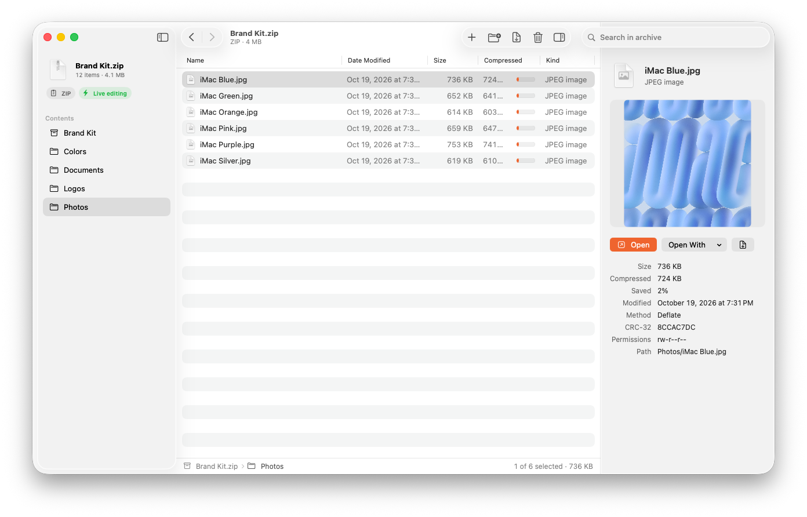
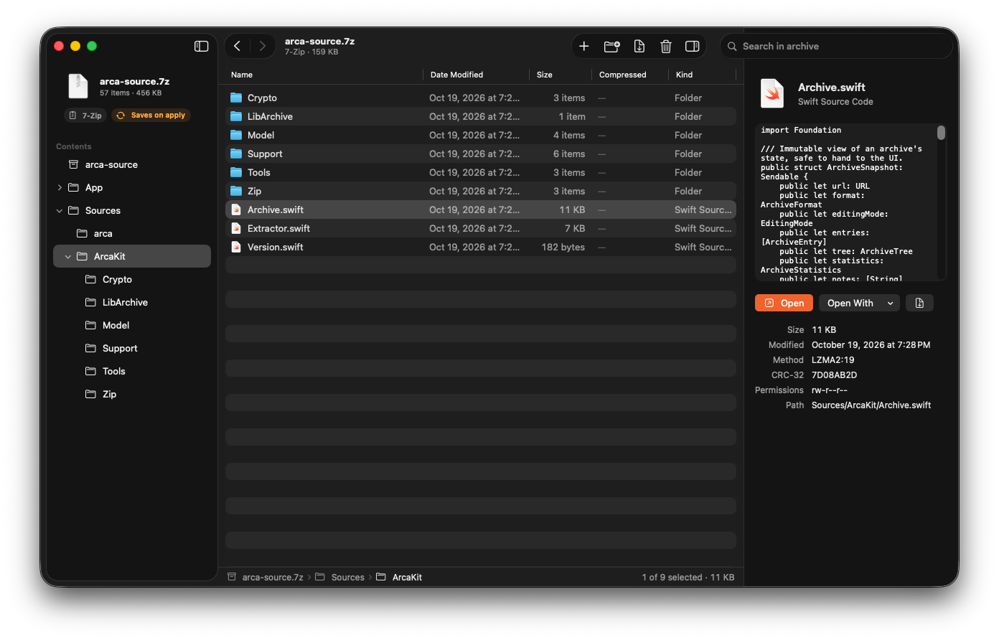
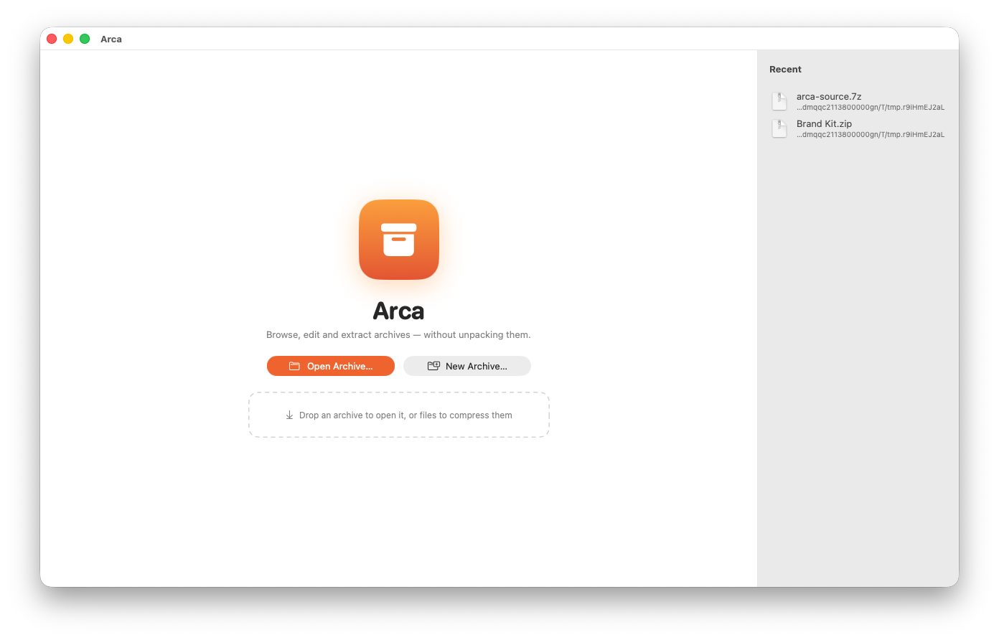

<p align="center">
  
</p>

<h1 align="center">Arca</h1>

<p align="center">
  <b>The archive manager that edits archives without unpacking them.</b><br>
  Native macOS · SwiftUI · ZIP, 7z, RAR, TAR, DMG and 30+ formats
</p>

<p align="center">
  <a href="https://github.com/marcovisona/symmetrical-waddle/releases/latest"></a>
  <a href="https://github.com/marcovisona/symmetrical-waddle/actions/workflows/ci.yml"></a>
  
  <a href="LICENSE"></a>
</p>

<p align="center">
  
</p>

Browse an archive like a folder, open any item in its app and **write the changes back into the archive on save**. Add, rename and delete entries **without unpacking and recompressing the whole thing**: adding a 1 KB file to a 10 GB ZIP writes about 1 KB.

## Contents

- [Killer features](#killer-features)
- [Screenshots](#screenshots)
- [Install](#install)
- [Supported formats](#supported-formats)
- [How editing works](#how-editing-works)
- [App features](#app-features)
- [Command-line tool](#command-line-tool)
- [Build from source](#build-from-source)
- [Architecture](#architecture)
- [Known limitations](#known-limitations)
- [Roadmap](#roadmap)
- [Contributing](#contributing)
- [License](#license)

## Killer features

- ⚡️ **Edit in place, not unpack-and-repack.** New and replaced ZIP entries are appended where the old index was; untouched entries are never read, decompressed or rewritten. Renames and moves copy the compressed bytes as they are.
- 🛡️ **Crash-proof commits.** Every ZIP change is journaled before it touches the file. A crash, power loss or cancellation rolls the archive back **byte for byte**, verified by fault-injection tests at every stage.
- ✍️ **Live editing in any app.** Double-click a file inside the archive, edit it in Preview, Pages, VS Code or Photoshop, hit save: Arca writes it straight back into the archive.
- 🧰 **The formats that matter, done by the experts.** 7z through the bundled 7-Zip, RAR through RARLAB's own `rar`, everything else through libarchive. Formats are recognized by content, so a `.cbz` that is really a 7z just opens.
- 💿 **Disk images without mounting clutter.** DMGs, encrypted ones included, are attached read-only and invisibly, then browsed like any archive.
- 🔐 **Strong encryption.** AES-256 for ZIP (WinZip AE-2), 7z and RAR, with encrypted file names where the format allows it.
- 🍎 **Truly native.** SwiftUI with Liquid Glass on macOS 26, Quick Look for archives in Finder, Finder Services, drag & drop both ways, no runtime to install.
- 🖥️ **Scriptable.** The same engine ships as the `arca` command-line tool.

## Screenshots

| Light | Dark |
|---|---|
|  |  |

<p align="center">
  
</p>

## Install

Download the latest `Arca-x.y.z.dmg` from [Releases](https://github.com/marcovisona/symmetrical-waddle/releases) and drag Arca to Applications.

Preview builds are signed ad hoc, not notarized yet. On first launch, allow Arca in **System Settings → Privacy & Security → Open Anyway**, or:

```bash
xattr -dr com.apple.quarantine /Applications/Arca.app
```

Optional, to edit and create RAR archives: `brew install --cask rar`.

Requires macOS 14 Sonoma or later, on Apple silicon or Intel.

## Supported formats

| | Browse / Preview / Extract | Editing | Encryption |
|---|---|---|---|
| ZIP, JAR, APK, IPA, DOCX, EPUB, CBZ, APPX/MSIX… | ✓ | **Live, in-place** — only new data is written | AES-256 read/write, ZipCrypto read |
| 7z, CB7 | ✓ | Untouched blocks copied, only touched blocks recompressed (7-Zip) | AES-256 + encrypted file names |
| RAR 4/5, CBR | ✓ incl. encrypted RAR5 and multi-volume | With `rar` installed: untouched items copied as-is | AES-256 + encrypted file names (`rar`) |
| TAR, CBT | ✓ | Streaming rewrite (byte copy, no compression) | — |
| TAR.GZ / .BZ2 / .XZ / .ZST / .LZ4 | ✓ | Streaming rewrite (outer compression redone, no extraction to disk) | — |
| DMG | ✓ mounted read-only and invisibly (`hdiutil`, also APFS/encrypted) | Read-only | Password |
| ISO, UDF, WIM, VHD/VHDX, MSI, SquashFS, CHM, ARJ, CAB | ✓ | Read-only | — |
| XAR/PKG/XIP, CPIO, RPM, DEB/AR, LHA | ✓ | Read-only | — |
| .gz / .bz2 / .xz / .zst (single file) | ✓ | Read-only | — |

Archives nested in archives open in a new window with a double-click; if you edit them, the changes flow back into the parent archive.

## How editing works

### ZIP: in-place append + journal

ZIP compresses every entry on its own and keeps the index (central directory, CD) at the end of the file. A commit:

1. saves the **tail** of the file (old CD + EOCD, usually a few KB) in a **journal** (`~/Library/Application Support/Arca/Journals`), with `fsync`;
2. writes new or replaced entries **starting from the old CD's offset**;
3. writes the new CD + EOCD (ZIP64 when needed), truncates, then runs `F_FULLFSYNC`;
4. deletes the journal.

Untouched entries are **never read or rewritten**: adding a 1 KB file to a 10 GB archive writes about 1 KB plus the CD. Rename/move copies the compressed bytes as-is under a new local header (no decompression). Deleted entries become dead space, which the **Compact** command (manual or automatic past 40%) reclaims by copying entries byte for byte into a new file that atomically replaces the original.

**Crash safety.** Any interruption (crash, power loss, cancellation, I/O error) is recoverable: restoring the tail from the journal and truncating gives back the original archive **byte for byte**. Recovery runs on rollback and automatically on the next open. The tests check this with fault injection at every stage.

### TAR family: streaming rewrite

`tar.gz/xz/zst` is a single compressed stream, so changing one entry means re-streaming the archive. libarchive reads the source and writes a temp file next to it, copying unchanged entries' data block by block without touching disk with extracted files, then does an atomic `rename(2)`. In the UI, changes are **staged** (shown in the browser with Added / Modified / Renamed badges) and applied in a single pass with ⌘S.

### 7z and RAR: external engines, atomic batches

7z and RAR go through the tools of their authors, which know them better than any reimplementation:

- **7-Zip** (`7zz`, LGPL) is **bundled in the app** (`Contents/MacOS/7zz`, universal arm64/x86_64). It's downloaded at build time by `App/Scripts/fetch-7zz.sh` (pinned version + SHA-256), signed together with the app, and ships with its license in `Contents/Resources`. It also handles reading RAR (encrypted RAR5 and multi-volume included), WIM, VHD, MSI, SquashFS, CHM, ARJ, UDF.
- **RAR** writing is reserved to RARLAB's tool, which can't be redistributed. If `rar` is installed (`brew install --cask rar`), RAR archives become editable and can be created; otherwise they're read-only.

Format detection goes by content (magic bytes), so a `.cbz` that is really a 7z opens correctly. Changes are batched (consecutive additions → one `a`, deletions → one `d`, renames → one `rn`) and applied to an **APFS clone** of the archive, which replaces the original atomically only if the whole batch succeeds. Cancellation kills the process and leaves the original intact. Both 7-Zip and RAR copy the compressed data of untouched files; in solid archives only the blocks containing modified files are recompressed.

### Live editing in external apps

Double-clicking an entry extracts **only that entry** into a private temp folder and opens it in the default app (or "Open With…"). The folder is watched with `DispatchSource` (on the folder, not the file, because editors save atomically with rename/exchange). When the app saves, Arca offers "Update Archive" (or does it automatically, see Settings), and the entry is rewritten in place.

## App features

- Sidebar with folder tree, archive card (format, editing mode, encryption)
- Finder-style table: icons, sizes, compression bar per entry, sorting, search across the whole archive
- Inspector with embedded Quick Look preview, metadata (method, CRC, permissions), Open / Open With / Edit as Text
- Drag & drop: from Finder into the archive (or onto a sidebar folder), and from the archive to Finder (extraction on demand)
- Spacebar → Quick Look, ⌘↓ open, Return rename, ⌘⌫ delete, ⌘E extract, ⌥⌘E extract all, ⌘S apply
- Password sheet with retry (including archives with encrypted headers); "Encrypt added items (AES-256)" toggle on ZIPs
- Progress with cancellation (the archive stays intact)
- Warnings for signed JAR/APK/IPA and legacy ZipCrypto
- Quick Look extension (archive contents from Finder) and Services "Compress with Arca" / "Extract with Arca" (smart extraction like Archive Utility)

## Command-line tool

```bash
swift run arca list   archive.zip
swift run arca add    archive.zip notes.md docs/notes.md     # in-place
swift run arca mv     archive.zip docs documentation          # raw copy, no recompression
swift run arca rm     archive.zip old/
swift run arca create backup.tar.xz ~/Projects/foo
swift run arca add    secret.zip report.pdf -p "password"     # AES-256
swift run arca compact archive.zip
```

## Build from source

Requirements: Xcode 26 (Swift 6.2), macOS 14+.

```bash
# core + tests
swift test

# app
brew install xcodegen
cd App && xcodegen && open Arca.xcodeproj

# or a Release build from the command line (ad-hoc signed)
App/Scripts/build-app.sh dist
```

The first build downloads 7-Zip (pinned version, checksum-verified). Set `DEVELOPMENT_TEAM` in `App/project.yml` (or in Xcode) to sign with your team; `SIGN_IDENTITY="Developer ID Application: …" App/Scripts/build-app.sh dist` does the same from the command line. On Linux (CI), the core needs `libarchive-dev` and `zlib1g-dev`.

### Releasing

1. Bump `MARKETING_VERSION` in `App/project.yml` and `ArcaVersion.string` in `Sources/ArcaKit/Version.swift`, and add a section to `CHANGELOG.md`.
2. Push a tag `vX.Y.Z` (or run the workflow by hand with the tag name). The [Release workflow](.github/workflows/release.yml) builds the app (DMG and zip), the universal CLI and checksums, and opens a **draft** release with the changelog section as notes.

Screenshots are regenerated by the manual [Screenshots workflow](.github/workflows/screenshots.yml).

## Architecture

```
Package.swift            SwiftPM: ArcaKit (core), arca (CLI), tests
Sources/ArcaKit/
  Archive.swift          Public, thread-safe facade (async, private serial queue)
  Extractor.swift        Extraction with zip-slip / symlink-escape protection
  Zip/                   ZIP engine: parsing, ZIP64, in-place commit, journal
  LibArchive/            Backend for other formats + tar streaming rewrite
  Crypto/                WinZip AES (CommonCrypto on Apple), ZipCrypto
  Model/                 Entries, tree, edit planning
Sources/CArchive         libarchive module map (vendored BSD headers, links the system libarchive)
Sources/arca             CLI: list/info/cat/extract/add/rm/mv/mkdir/compact/create
App/                     macOS app (XcodeGen): SwiftUI, Quick Look extension, Finder Services
```

- **Swift 6 + SwiftUI** (NavigationSplitView, Table, Inspector, `@Observable`); **Liquid Glass** on macOS 26 for floating surfaces, with a material fallback on 14–15.
- **libarchive** from the system (`/usr/lib/libarchive.2.dylib`, part of macOS): no binaries to distribute. The macOS SDK ships `libarchive.tbd` but not the headers, which are vendored in `Sources/CArchive/include` (BSD-2).
- **Own ZIP engine** instead of libarchive or ZIPFoundation: neither supports byte-level in-place editing with transactional rollback.
- **zlib** (system) for deflate; **CommonCrypto** for AES/HMAC/PBKDF2. A portable pure-Swift implementation exists only to compile and test the core on Linux.
- Distribution: **Developer ID + notarization** (Hardened Runtime, no sandbox: in-place editing and Services need direct access to the files). The Quick Look extension is sandboxed.

## Known limitations

- RAR editing requires `rar` (RARLAB, shareware) installed by the user; it can't be bundled.
- DMG, WIM, VHD, MSI, ISO and the other image/installer formats are read-only.
- ZIP: entries with methods other than Store/Deflate (Deflate64, PPMd, LZMA, zstd…) are extracted via 7-Zip. Multi-volume ZIPs aren't supported.
- The system libarchive may lack some codecs depending on the macOS version (e.g. writing zstd/lz4): the app reports the error when the change is applied. If needed, link a static libarchive build in place of the system one.
- Staged changes on tar.* that haven't been applied are lost when the window closes.
- Preview builds aren't notarized yet.

## Roadmap

Arca is actively evolving. Contributions and
suggestions are welcome!

### Archive Format Conversion

- Convert archives between supported formats.
- Preserve directory structure and metadata
  whenever possible.
- Choose the destination format and compression level.
- Provide progress reporting and cancellation.

### Improved Encryption Management

- Encrypt existing unencrypted files in ZIP archives.
- Apply encryption to an entire archive.
- Change or remove archive passwords.
- Clearly identify encrypted and unencrypted entries.
- Improve handling of archives containing mixed
  encrypted and unencrypted files.

### Usability and Reliability

- Improve accessibility and VoiceOver support.
- Expand automated testing.
- Add reproducible performance benchmarks.
- Improve handling of unsaved changes.

## 🤝 Contributing

Contributions are welcome!

Arca is an open-source project, and we're looking
for developers interested in Swift, SwiftUI,
archive formats, performance, and macOS development.

Whether you want to fix a bug, improve the UI,
add tests, or suggest a feature, you're welcome.

Check out our
[good first issues](https://github.com/marcovisona/arca/labels/good%20first%20issue)
to get started.

Please read [CONTRIBUTING.md](CONTRIBUTING.md)
before submitting a pull request.

## License

Arca is released under the [MIT License](LICENSE). It bundles 7-Zip (GNU LGPL, with the unRAR restriction) and uses the system libarchive (BSD): see [THIRD_PARTY_NOTICES.md](THIRD_PARTY_NOTICES.md).
